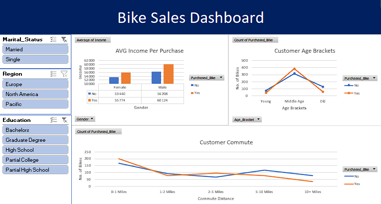

# Bike Sales Performance Analysis

## Project Overview
This project analyzes demographic data from a bike retail dataset to understand the core drivers behind customer purchasing decisions. By evaluating key variables such as **average income per purchase**, **customer commute distances**, and **targeted age brackets**, this analysis identifies which consumer segments are most likely to buy a bike. 

## Interactive Dashboard Preview

## Technical Skills Demonstrated
* **Data Cleaning & Preparation:** Removed duplicate records, standardized text formatting, and handled missing values using Excel formulas.
* **Data Categorization:** Built nested `IF` statements to segment raw numerical ages into clean, readable age brackets (Young, Middle Age, Old).
* **Data Modeling:** Created multiple interconnected Pivot Tables to isolate variables across income, distance, and age.
* **UI/UX Dashboard Design:** Developed a polished visual interface featuring cohesive dynamic charts, interactive **Slicers** (for gender, education, and region), and clean timeline filters for seamless stakeholders exploration.

## Repository Contents
* `Bike_Sales_Analysis.xlsx` - The master workbook containing the raw data, processed sheets, and the final interactive dashboard.
* `Dashboard.png` - A high-resolution screenshot of the analytical dashboard.
